# JetInspect-M

**ROS 2 기반 이동형 로봇의 자율주행·인식·조작과 웹 관제를 연결하는 프로젝트**

Hiwonder JetRover의 메카넘 구동부와 로봇팔을 바탕으로, Jetson Orin Nano에서 센서 데이터 수집부터 Nav2 주행, RGB-D 인식, Gazebo 임무, 웹 대시보드와 문서 검색까지 단계적으로 구현하고 있습니다. 저수준에서는 STM32 통신 프로토콜을 분석하고 ROS 2 드라이버와 자체 펌웨어를 개발했습니다.

> **프로젝트 상태 · 2026-11-18:** 웹 관제와 모의/Gazebo 임무, 센서 보정 도구, 로컬 지식 검색이 구현되어 있습니다. 실제 로봇의 전체 자율 임무 연결과 안전 검증은 진행 중입니다. 대시보드의 임무 실행은 **모의 또는 Gazebo 전용**이며 실기 주행·팔 제어 기능이 아닙니다.


## 한눈에 보기

| 영역 | 구현 내용 | 검증 범위 |
|---|---|---|
| 로봇 기반 | RRC 시리얼 프로토콜, 베이스 드라이버, 자체 STM32 펌웨어, 엔코더·IMU 기반 상태 추정 | 센서·펌웨어 및 일부 주행 실기 시험 |
| 자율주행 | SLAM Toolbox, AMCL, Nav2, LiDAR와 depth 장애물 입력 | 실제 지도·주행과 Gazebo 시험; 회피 안전성 추가 검증 필요 |
| 인식·조작 | Orbbec RGB-D, 좌표 변환, 큐브 인식·MoveIt2, 경광등 색상 관측 | 일부 집기 실기 및 가상 경광등 시험; 실제 설비 판정 미검증 |
| 웹 관제 | React·FastAPI, 로그인·권한, 센서 연결·상태, 카메라, MySQL 이력, 보정 작업 공간 | 브라우저·API 및 일부 센서 연동 시험; 실제 로봇 구동 미연결 |
| 임무 관리 | 생성·실행·취소·상태 이력, Gazebo 주행 및 가상 경광등 점검 | 모의 및 격리 Gazebo 시험; 실기 임무 관리자 미연결 |
| 지식 검색 | Qdrant 로컬 벡터 DB, 다국어 임베딩, 문서 근거 검색 및 대시보드 탐색 | 검색 평가 수행; 생성형 답변의 사실성 개선 필요 |
| 음성 | Whisper 기반 STT, 로컬 Qwen·선택형 클라우드 LLM, Piper TTS 시험 | 단발 음성 시험; 상시 청취·실기 임무 연동 미완료 |

## 로봇 외형과 URDF 모델

메카넘 휠과 로봇팔을 장착한 JetRover의 제조사 제품 이미지와, 이 저장소의 URDF를 RViz에서 홈 자세의 가상 관절값으로 표시한 화면입니다. 제품 사진은 실제 프로젝트 기기를 촬영한 사진이 아닙니다. [제품 이미지 출처: Hiwonder](https://www.hiwonder.com/products/jetrover) · [URDF 모델](src/jetrover_description/urdf/jetrover.xacro)

| JetRover 제품 외형 | 프로젝트 URDF 모델 · RViz |
|:---:|:---:|
|  | 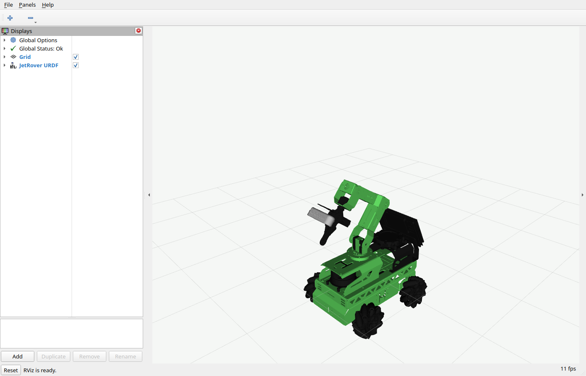 |

## 디지털 트윈과 실제 지도

### RGB-D 방 스캔 → Open3D 재구성

실제 로봇의 RGB-D·LiDAR 데이터를 약 371초 녹화하고 RTAB-Map으로 자세를 추정한 뒤, Open3D TSDF로 방 메쉬를 만들었습니다. 기존 2D 지도와 정합한 잔차 중앙값은 **4.4 cm**였으며, 이후 메쉬를 경량화하고 텍스처를 적용해 Gazebo 월드로 가져갔습니다. 이는 특정 데이터와 조건에서의 결과이며 모든 환경에서의 정확도를 뜻하지 않습니다. [스캔·정합·Gazebo 시험 기록](docs/benchmarks/sim/room_scan_20261014.md)

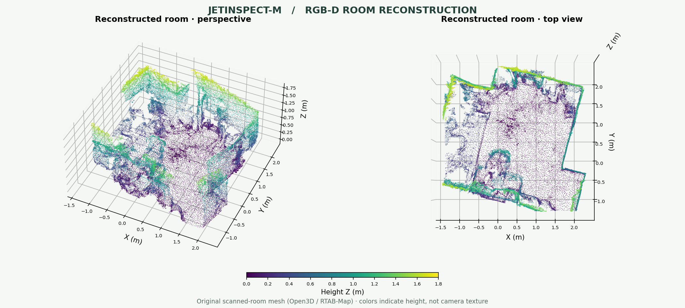

*저장소의 실제 재구성 GLB 메쉬에서 정점 10만 개를 표본 추출해 다시 그린 시각화입니다. Open3D 프로그램 스크린샷은 아니며, 색상은 카메라 텍스처가 아닌 높이(Z)를 나타냅니다.*

### Open3D 재구성 메쉬와 Gazebo 월드

아래 첫 화면은 저장된 방 메쉬를 **Open3D 0.20에서 직접 열어** 촬영한 것입니다. 원본 TSDF 재구성 작업은 Open3D 0.19로 수행했고, 이 화면에는 Gazebo용으로 경량화하고 텍스처를 적용한 메쉬를 사용했습니다.

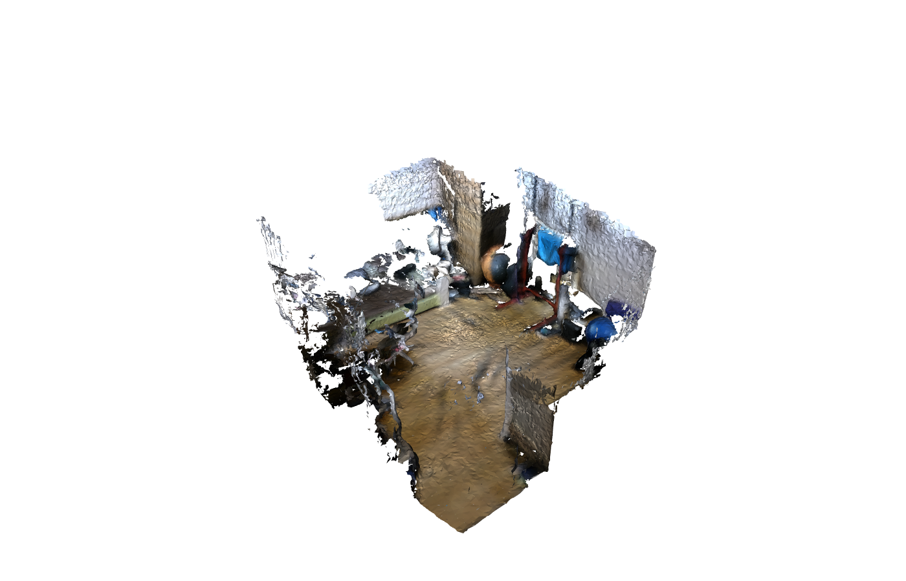

두 번째 화면은 같은 스캔 방을 가져온 **Gazebo 시뮬레이션**에 JetRover 모델과 가상 장애물을 배치한 모습입니다. 주행 명령 없이 캡처했으며 실제 주행 결과가 아닙니다.

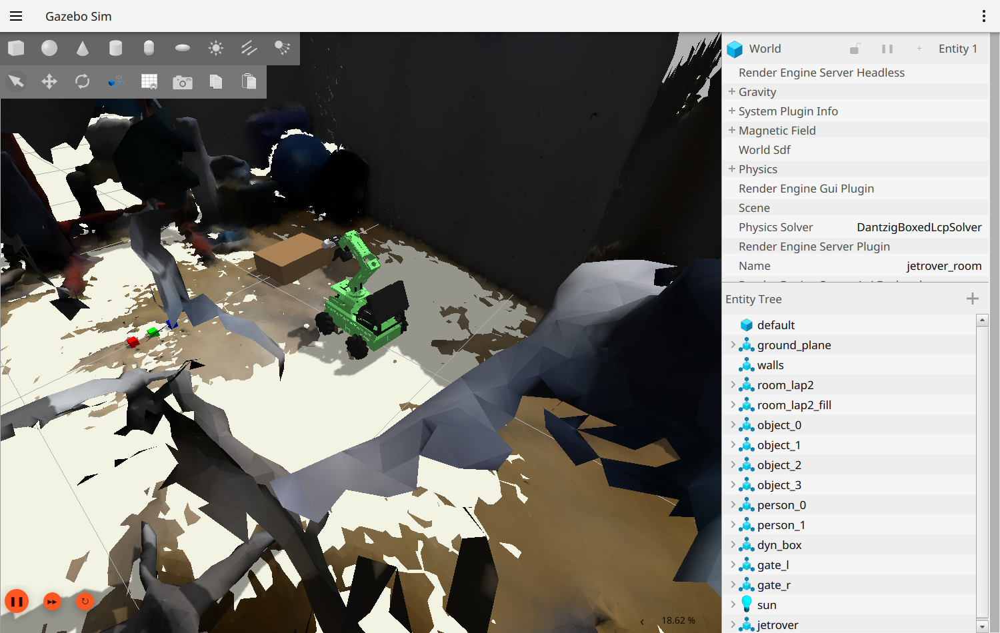

### SLAM 지도와 LiDAR 스캔

실제 로봇을 한 바퀴 수동 주행하며 만든 지도와 당시 LiDAR 스캔입니다. 흑백 지도에 스캔 거리와 로봇 위치를 겹쳐 보여줍니다. [SLAM 진행 기록](checklist/PROJECT_CHECKLIST.md)

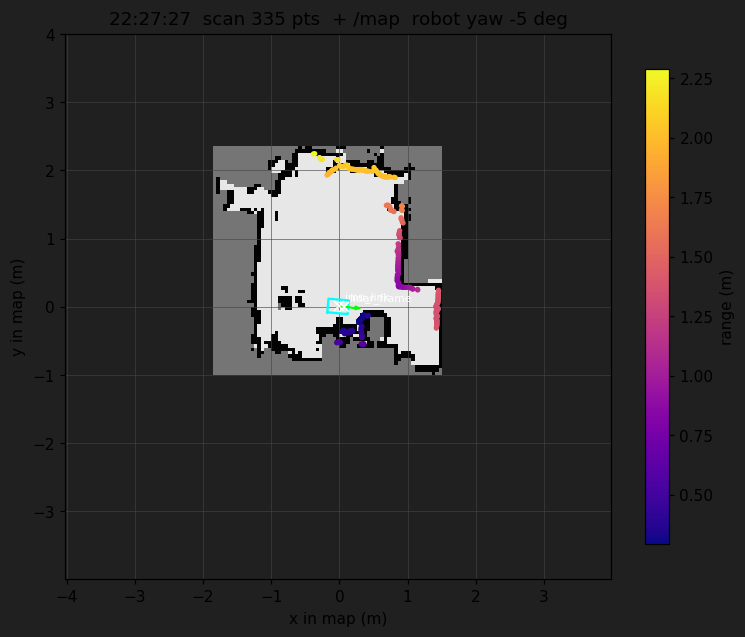

## 프로젝트 화면

아래 대시보드 이미지는 **실제 UI를 격리된 시험 서버에서 샘플 데이터로 캡처한 화면**입니다. 표시된 수치와 임무 결과는 포트폴리오용 예시입니다.

### 운영 상태와 센서 연결

센서 서비스와 수신 상태, 배터리·호스트 자원 및 이력을 확인합니다. 서비스 실행 여부와 센서 데이터 수신 여부는 별도로 표시합니다.

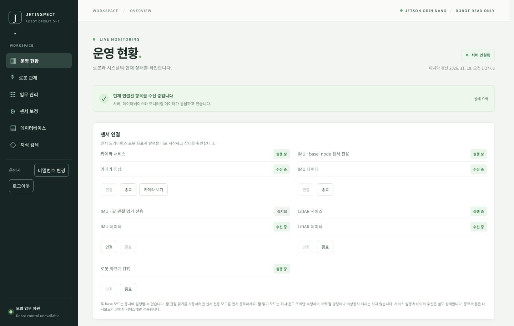

### 모의·Gazebo 임무 관리

임무를 생성하고 실행·취소하며 단계별 상태와 결과를 확인합니다. 아래 이미지는 **가상 경광등 점검 결과 예시**입니다.


### 문서 기반 지식 검색

프로젝트 문서를 색인하고 검색 결과와 출처를 확인합니다. 기본 답변은 검색된 원문을 보여주며 생성형 답변은 별도로 선택합니다.

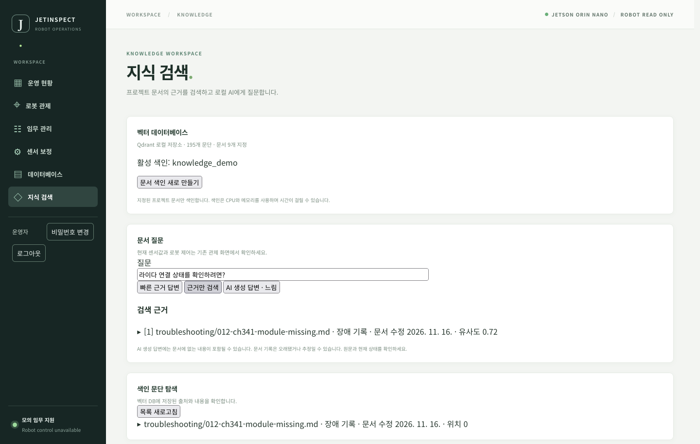

### 센서 보정 작업 공간

IMU, 카메라, LiDAR와 주행·로봇팔 관련 보정 항목을 선택하고 측정 및 결과를 검토합니다. 아래는 **시험 서버에서 캡처한 UI**이며 보정 정확도나 실기 적용 성공을 뜻하지 않습니다.

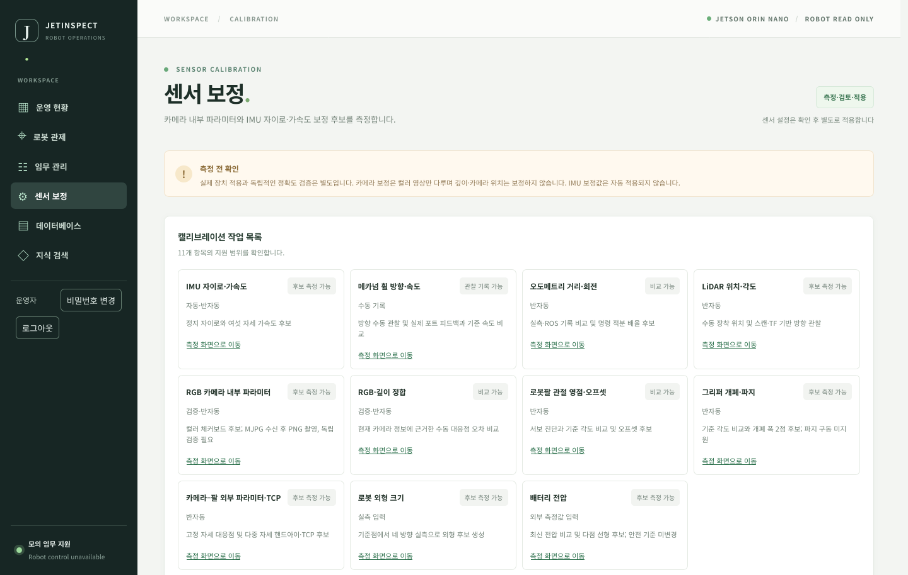

### 실제 RGB-D 영상과 정합 확인

정지 상태의 실제 카메라로 촬영한 컬러·깊이 영상과 RGB 영상에 깊이 경계를 표시한 검증 기록입니다. 깊이 영상은 미터 단위이며 흰 부분은 유효한 깊이값이 없는 영역입니다. [촬영 자세와 측정 기록](docs/benchmarks/perception/scan_pose_20261010.md) · [정합 확인 기록](checklist/PROJECT_CHECKLIST.md)

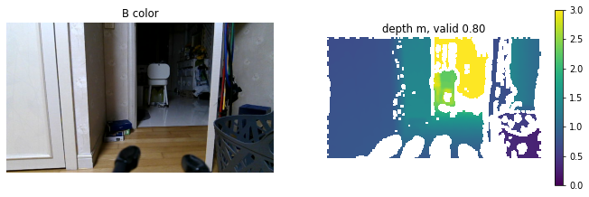

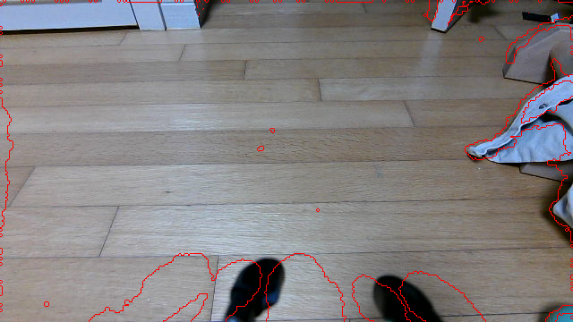

### Nav2 장애물 비용지도

기존 시험에서 저장한 로컬·글로벌 비용지도 시각화입니다. 각 지도 위의 사각형과 화살표는 로봇의 위치와 방향을 나타냅니다. 이 화면만으로 주행 안전성을 판단할 수는 없습니다.

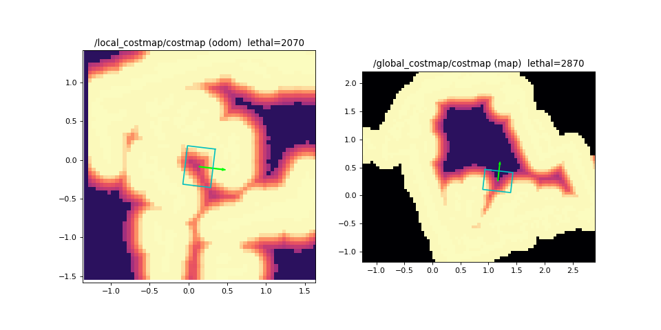

### RGB-D 포인트클라우드

Orbbec 카메라의 깊이 정보를 이용한 포인트클라우드 확인 기록입니다. 좌측은 위에서 본 점 분포, 우측은 정면 투영입니다. 이미지와 측정 조건은 [카메라 검증 기록](checklist/PROJECT_CHECKLIST.md)을 참고하세요.

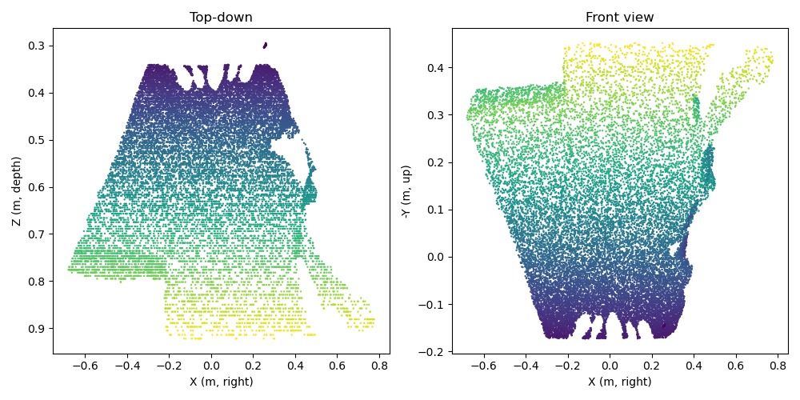

## 기능 상세

### 웹 관제와 데이터 관리

- **운영 현황:** CPU·메모리·저장 공간·온도 추이, 배터리 전압, IMU·LiDAR·카메라의 수신율과 마지막 수신 시각을 표시합니다. 서비스가 실행 중인 상태와 데이터가 실제로 들어오는 상태를 구분합니다.
- **로봇 관제:** 카메라 정지 화면을 주기적으로 갱신하고 저장된 지도와 Gazebo 위치, 진행 중인 모의 임무를 보여줍니다. 실제 로봇 위치와 실기 임무 관리자는 연결되지 않았습니다.
- **계정과 접속:** HTTPS, `operator`·`viewer` 역할, 로그인 및 비밀번호 변경을 지원합니다. 운영자는 카메라·IMU·LiDAR 서비스와 팔 관측 모드를 관리할 수 있습니다. 센서 연결은 로봇 구동 명령을 보내지 않는 전용 모드를 사용합니다. [접속·인증 및 센서 연결 안내](tools/ops/README.md)
- **데이터베이스:** MySQL에 시스템 지표·운영 이벤트·임무와 이력을 기록하고, 화면에서 테이블을 페이지별로 조회하고 긴 행을 확인·복사할 수 있습니다. 임의 SQL 실행과 데이터 편집은 제공하지 않습니다. [데이터베이스 탐색](tools/ops/README.md#데이터베이스-탐색)
- **임무:** 모의 점검과 Gazebo 주행·가상 경광등 점검의 생성, 실행, 취소, 단계별 상태 및 결과 이력을 제공합니다. Gazebo 환경은 임무별로 시작·종료하며 실제 로봇 임무와는 분리됩니다. [임무 관리](tools/ops/README.md#모의-임무-관리) · [Gazebo 점검](tools/ops/README.md#gazebo-경광등-점검-임무)

### 센서와 로봇 보정

대시보드는 **11개 보정 작업**의 측정·수동 입력·비교 결과와 후보 이력을 관리합니다. 적용을 지원하는 항목은 현재값과 후보를 확인한 뒤 별도로 적용하고 백업을 복원할 수 있습니다. 항목마다 가능한 동작이 다르며, 보정 화면은 바퀴나 팔을 구동하지 않습니다. [상세 절차와 적용 범위](tools/ops/README.md#센서-보정-후보)

| 작업 | 지원 내용 |
|---|---|
| IMU | 정지 자이로 bias, 사용자가 로봇을 지지하는 6자세 가속도 offset·축별 scale 후보와 별도 설정 적용 |
| 휠 · 오도메트리 | 휠 방향 관찰·외부 기준 속도 비교, 이동 기록 비교 및 명령 적분 배율 후보. **MCU 휠 PID 적용은 미지원** |
| LiDAR | 설치 위치 입력, 스캔·TF 방향 비교 및 독립 실측한 위치·장착 yaw 적용 |
| RGB 카메라 · RGB-D | 체커보드 컬러 내부 보정, CameraInfo 비교, 색상·깊이 정합 확인과 정합 모드 설정 |
| 팔 관절 · 그리퍼 | 관절 피드백과 기준 각도 비교·오프셋 후보, 그리퍼 개폐 폭 후보. 그리퍼 폭 보정은 화면 표시용 |
| 카메라–팔 · TCP | 3차원 대응점, 체커보드·TF 기반 핸드아이 및 TCP 접점 후보와 별도 설정 적용 |
| 로봇 외형 · 배터리 | 실측 외형을 기본 Nav2 footprint에 반영, 외부 측정 전압으로 대시보드 표시값 보정 |

RGB-D 외부 변환은 별도 보정 노드에 적용해 보정 깊이 영상을 발행하고, 큐브 인식이나 장애물 처리의 입력으로 선택할 수 있습니다. 카메라의 공장 파라미터를 바꾸지 않으며, 실제 원본 모드와 정합 정확도·주행 안전성은 별도 검증이 필요합니다. [RGB-D 보정 경로와 제한](tools/ops/README.md#rgb-d-외부-변환-소프트웨어-적용)

### 인식·조작과 시뮬레이션

- **RGB-D 인식:** 색상 큐브 영역과 깊이를 이용해 3차원 위치·방향을 구하고 TF로 로봇 좌표계에 변환합니다. 깊이 장애물 점은 기준 영상과 비교하며 팔 자세 등의 조건을 확인합니다. [인식 도구](tools/perception/README.md) · [큐브 집기 절차](src/jetrover_manipulation/README.md)
- **로봇팔:** MoveIt2 계획을 팔·그리퍼 제어 브리지에 연결하고, 서보 응답 신선도와 동시 명령을 검사합니다. 접촉 기반 파지·유지와 명시적 해제를 지원합니다. 교시 보정 후 색상 큐브 실기 자동 집기 **3/3** 기록이 있지만 다른 조명·반복 조건의 검증은 남았습니다. [실기 시험과 제한](docs/benchmarks/arm_teach_20261018.md)
- **주행·디지털 트윈:** URDF와 메카넘·팔·LiDAR·RGB-D·IMU 모델, 스캔 방 월드, Nav2 주행 및 장애물 시나리오와 집기 시험 도구를 제공합니다. MPPI용 메카넘 횡방향 제한 critic도 구현되어 있습니다. [Gazebo 구성](src/jetrover_gazebo/README.md) · [시뮬레이션 시나리오](tools/sim/README.md) · [Nav2 플러그인](src/jetrover_nav_plugins)
- **MCU 실험:** RRC 외에 micro-ROS 펌웨어와 호스트 브리지 경로도 별도로 제공하지만 기존 베이스 드라이버와 동일한 시리얼 포트를 공유합니다. [통신 모드](firmware/rrc_m4/README.md) · [호스트 패키지](src/jetrover_microros)

### 지식 검색과 음성 실험

- **검색·벡터 DB:** 허용된 프로젝트 문서를 Qdrant 로컬 DB에 색인하고, 벡터 유사도와 한국어 부분 문자열 검색, 인접 문맥 및 출처를 결합합니다. 대시보드에서 색인 현황과 문서 청크를 탐색하고 운영자가 색인을 갱신할 수 있습니다. 기본 답변은 근거 원문이며 로컬 모델 생성 답변은 선택 사항입니다. 임의 파일 업로드와 임무·음성 이력 자동 수집은 미지원입니다. [검색 구성과 제한](tools/ops/README.md#지식-검색과-벡터-데이터베이스)
- **음성·이미지:** 단발 녹음 → Whisper STT → 로컬 또는 선택적 클라우드 LLM → Piper TTS 경로와, LangGraph 기반 로컬·클라우드·이미지 이해 분기 실험이 있습니다. 이미지 전송은 별도 허용이 필요하며 음성에서 로봇 임무를 실행하지 않습니다. [음성 실행·검증](tools/voice/README.md)
- **오디오 진단:** 모노 소음 억제, 다채널 방향 추정 및 빔포밍 시험 도구가 있습니다. 방향성 집음은 합성 입력 중심의 실험이며 실제 방향 판정이나 로봇 제어에 연결되어 있지 않습니다. [오디오 실험 범위](tools/audio/README.md)

## 시스템 구성

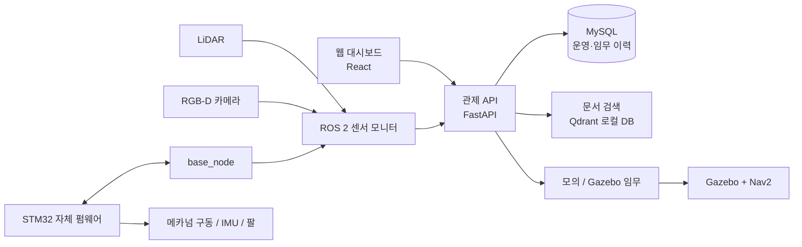

도식은 주요 데이터 흐름을 간략하게 나타냅니다. 실제 로봇으로 임무 명령을 보내는 경로는 아직 대시보드에 연결하지 않았습니다. RAG 답변은 로봇 제어나 안전 판단에 직접 사용하지 않습니다.

## 주요 구현과 확인한 결과

- **센서·펌웨어:** RRC 프레임과 STM32 드라이버를 구현하고 자체 `rrc_m4` 펌웨어를 실기에 적용했습니다. 엔코더 피드백이 들어오면 측정 바퀴 속도를 사용하고, 수신이 끊기면 명령 기반 값으로 대체하며 경고합니다. 센서 전용 모드는 바퀴·팔 구동 명령을 전송하지 않도록 분리했습니다. [프로젝트 지침과 확인된 사실](AGENTS.md)
- **Gazebo 임무:** 격리 환경에서 대시보드 임무 API → Gazebo/Nav2 주행을 2회 성공시켰고, 가상 경광등 점검 전체 흐름을 별도 반복 시험했습니다. 이는 실제 설비 또는 로봇의 장시간 안정성 검증이 아닙니다. [주행 시험 기록](docs/benchmarks/sim/mission_dashboard_gazebo_20261116.md) · [경광등 시험 계획과 결과](prd/gazebo-stack-light-test-plan.md)
- **보정 작업 공간:** IMU 자이로·가속도, 카메라 내부 파라미터, RGB-D 정합, LiDAR 설치 변환, 주행·팔 관련 후보를 측정하거나 입력하고 검토·적용·복원하는 도구를 제공합니다. 항목별 적용 범위와 실제 정확도 검증 상태는 다릅니다. [보정 기능과 제한](tools/ops/README.md#센서-보정-후보)
- **RAG 검색:** 문서 의미 검색과 부분 문자열 일치, 인접 문맥을 사용합니다. 고정된 문단 평가 15문항에서 지정 근거 포함은 5→12건으로 개선됐고, 이후 작성한 8문항에서는 7건을 찾았습니다. 작은 표본과 문자열 일치 기반 평가이므로 일반적인 정확도를 보장하지 않습니다. [검색 평가](docs/benchmarks/rag/knowledge-search-improvement-20261118.md)
- **CI:** GitHub Actions에서 펌웨어 호스트 테스트, Python 정적 검사, ROS 2 Jazzy 빌드와 테스트를 수행합니다. 실기 안전성과 성능을 뜻하지 않습니다. [워크플로](.github/workflows/ci.yml)

## 하드웨어와 기술 스택

| 구분 | 구성 |
|---|---|
| 로봇 | Hiwonder JetRover · 메카넘 휠 · 5자유도 로봇팔 및 그리퍼 |
| 컴퓨팅 | NVIDIA Jetson Orin Nano 8GB · Ubuntu · ROS 2 Jazzy |
| 센서 | RPLIDAR A1M8 · Orbbec DaBai DCW RGB-D · IMU · 마이크 배열 |
| 저수준 | STM32F407 · 자체 `rrc_m4` 펌웨어 · RRC USB-UART 프로토콜 |
| 로봇 소프트웨어 | SLAM Toolbox · Nav2 · robot_localization · MoveIt2 · Gazebo Harmonic |
| 웹·데이터 | React · FastAPI · MySQL · Qdrant 로컬 모드 |
| 음성·AI | Whisper · Qwen · Piper · 다국어 임베딩; EXAONE API는 별도 비교 시험 |

## 시작하기

새 장치에서 환경을 구성할 때는 먼저 [환경 설정 기록](setup/ENVIRONMENT_SETUP.md)과 각 패키지의 README를 확인하세요. 사용자별 장치 경로와 네트워크 주소는 다를 수 있습니다.

### ROS 2 빌드와 시험

```bash
cd ~/jetrover_ws
source /opt/ros/jazzy/setup.bash

# Jetson의 메모리 부담을 줄이기 위해 병렬도를 제한합니다.
MAKEFLAGS=-j2 colcon build --parallel-workers 1 \
  --packages-select jetrover_interfaces jetrover_description jetrover_base \
  jetrover_microros jetrover_bringup jetrover_nav_plugins \
  jetrover_navigation jetrover_perception

colcon test --packages-select jetrover_base --parallel-workers 1
colcon test-result --verbose
```

DaBai DCW는 apt의 Orbbec SDK v2 드라이버와 호환 문제가 있어 SDK v1 기반 소스 오버레이를 사용합니다. 자세한 설치 및 재현 방법은 [카메라 오류 기록](troubleshooting/013-orbbec-sdk-v2-no-serial-bug.md)을 참고하세요.

### 웹 대시보드

대시보드 의존성, HTTPS 및 로그인 설정과 실행 방법은 [관제 환경 안내](tools/ops/README.md)에 정리되어 있습니다. 설정된 Jetson의 IP와 포트 `8765`로 같은 네트워크의 PC에서 접속합니다. `127.0.0.1`은 접속하는 PC 자신을 가리키므로 다른 PC에서 Jetson 주소로 사용할 수 없습니다.

## 안전과 남은 과제

- 실제 모터·로봇팔 구동 및 설정 변경은 별도 안전 준비와 승인이 필요합니다. 관제 화면은 비상정지 장치를 대체하지 않습니다.
- 실기 장애물 회피에는 추가 검증이 필요합니다. 깊이 필터가 사람의 발을 누락했던 사고와 후속 조치는 [안전 사고 기록](troubleshooting/056-depth-filter-removed-feet.md)에 남겨두었습니다.
- 실제 경광등 설비 점검, 실기 임무 관리자 연동, 캘리브레이션 정확도, 재부팅·장시간 동시 부하 시험이 남아 있습니다.
- 생성형 답변은 문서에 없는 내용을 만들 수 있습니다. 검색 결과와 출처를 직접 확인해야 합니다. EXAONE은 모델 비교만 진행했으며 현재 대시보드 답변에 연결되어 있지 않습니다. [모델 비교](docs/benchmarks/rag/exaone-local-comparison-20261118.md)

## 저장소 안내

| 경로 | 내용 |
|---|---|
| [`src/jetrover_base`](src/jetrover_base) | 베이스 드라이버·RRC 통신·IMU·바퀴 상태 |
| [`src/jetrover_navigation`](src/jetrover_navigation) | SLAM·Nav2 설정 및 정밀 접근 |
| [`src/jetrover_perception`](src/jetrover_perception) | 카메라·깊이 장애물·경광등 인식 |
| [`src/jetrover_manipulation`](src/jetrover_manipulation) | MoveIt2 설정과 팔 제어 브리지 |
| [`firmware/rrc_m4`](firmware/rrc_m4) | 자체 STM32 펌웨어 |
| [`tools/ops`](tools/ops) | 웹 대시보드·센서 연결·보정·지식 검색 |
| [`tools/mission`](tools/mission) | Gazebo 임무와 점검 시험 |
| [`tools/voice`](tools/voice) · [`tools/audio`](tools/audio) | 음성 파이프라인·오디오 및 방향 탐지 시험 |
| [`docs`](docs/README.md) · [`prd`](prd/README.md) | 아키텍처·시험 결과·기능 설계 |
| [`checklist`](checklist/PROJECT_CHECKLIST.md) · [`troubleshooting`](troubleshooting/README.md) | 진행 상황과 원인·해결 기록 |

`.env`, 빌드 산출물, 로컬 지도 직렬화 데이터 및 재배포 권한이 불분명한 벤더 자료는 저장소에 포함하지 않습니다. 상세 범위는 [환경 설정 기록](setup/ENVIRONMENT_SETUP.md)과 [프로젝트 지침](AGENTS.md)을 참고하세요.
