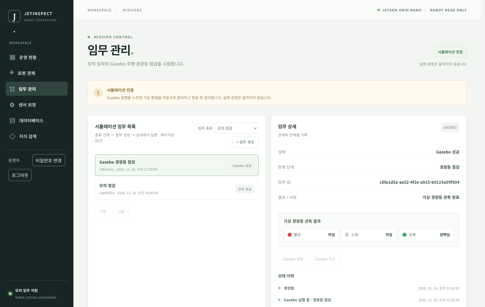
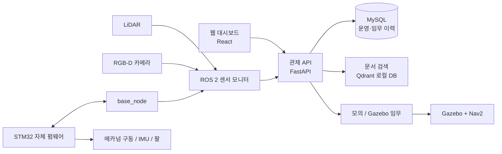

# JetInspect-M

**ROS 2 기반 이동형 로봇의 자율주행·인식·조작과 웹 관제를 연결하는 프로젝트**

Hiwonder JetRover의 메카넘 구동부와 로봇팔을 바탕으로, Jetson Orin Nano에서 센서 데이터 수집부터 Nav2 주행, RGB-D 인식, Gazebo 임무, 웹 대시보드와 문서 검색까지 단계적으로 구현하고 있습니다. 저수준에서는 STM32 통신 프로토콜을 분석하고 ROS 2 드라이버와 자체 펌웨어를 개발했습니다.

> **프로젝트 상태 · 2026-11-18:** 웹 관제와 모의/Gazebo 임무, 센서 보정 도구, 로컬 지식 검색이 구현되어 있습니다. 실제 로봇의 전체 자율 임무 연결과 안전 검증은 진행 중입니다. 대시보드의 임무 실행은 **모의 또는 Gazebo 전용**이며 실기 주행·팔 제어 기능이 아닙니다.


## 한눈에 보기

| 영역 | 구현 내용 | 검증 범위 |
|---|---|---|
| 로봇 기반 | RRC 시리얼 프로토콜, 베이스 드라이버, 자체 STM32 펌웨어, 엔코더·IMU 기반 상태 추정 | 센서·펌웨어 및 일부 주행 실기 시험 |
| 자율주행 | SLAM Toolbox, AMCL, Nav2, LiDAR와 depth 장애물 입력 | 실제 지도·주행과 Gazebo 시험; 회피 안전성 추가 검증 필요 |
| 인식·조작 | Orbbec RGB-D, 좌표 변환, 큐브 인식·MoveIt2, 경광등 색상 관측 | 일부 집기 실기 및 가상 경광등 시험; 실제 설비 판정 미검증 |
| 웹 관제 | React·FastAPI, 로그인·권한, 센서 연결·상태, 카메라, MySQL 이력, 보정 작업 공간 | 브라우저·API 및 일부 센서 연동 시험; 실제 로봇 구동 미연결 |
| 임무 관리 | 생성·실행·취소·상태 이력, Gazebo 주행 및 가상 경광등 점검 | 모의 및 격리 Gazebo 시험; 실기 임무 관리자 미연결 |
| 지식 검색 | Qdrant 로컬 벡터 DB, 다국어 임베딩, 문서 근거 검색 및 대시보드 탐색 | 검색 평가 수행; 생성형 답변의 사실성 개선 필요 |
| 음성 | Whisper 기반 STT, 로컬 Qwen·선택형 클라우드 LLM, Piper TTS 시험 | 단발 음성 시험; 상시 청취·실기 임무 연동 미완료 |

## 프로젝트 화면

아래 대시보드 이미지는 **실제 UI를 격리된 시험 서버에서 샘플 데이터로 캡처한 화면**입니다. 표시된 수치와 임무 결과는 포트폴리오용 예시입니다.

### 운영 상태와 센서 연결

센서 서비스와 수신 상태, 배터리·호스트 자원 및 이력을 확인합니다. 서비스 실행 여부와 센서 데이터 수신 여부는 별도로 표시합니다.


### 모의·Gazebo 임무 관리

임무를 생성하고 실행·취소하며 단계별 상태와 결과를 확인합니다. 아래 이미지는 **가상 경광등 점검 결과 예시**입니다.



### 문서 기반 지식 검색

프로젝트 문서를 색인하고 검색 결과와 출처를 확인합니다. 기본 답변은 검색된 원문을 보여주며 생성형 답변은 별도로 선택합니다.


### RGB-D 포인트클라우드

Orbbec 카메라의 깊이 정보를 이용한 포인트클라우드 확인 기록입니다. 좌측은 위에서 본 점 분포, 우측은 정면 투영입니다. 이미지와 측정 조건은 [카메라 검증 기록](checklist/PROJECT_CHECKLIST.md)을 참고하세요.


## 시스템 구성



도식은 주요 데이터 흐름을 간략하게 나타냅니다. 실제 로봇으로 임무 명령을 보내는 경로는 아직 대시보드에 연결하지 않았습니다. RAG 답변은 로봇 제어나 안전 판단에 직접 사용하지 않습니다.

## 주요 구현과 확인한 결과

- **센서·펌웨어:** RRC 프레임과 STM32 드라이버를 구현하고 자체 `rrc_m4` 펌웨어를 실기에 적용했습니다. 엔코더 피드백이 들어오면 측정 바퀴 속도를 사용하고, 수신이 끊기면 명령 기반 값으로 대체하며 경고합니다. 센서 전용 모드는 바퀴·팔 구동 명령을 전송하지 않도록 분리했습니다. [프로젝트 지침과 확인된 사실](AGENTS.md)
- **Gazebo 임무:** 격리 환경에서 대시보드 임무 API → Gazebo/Nav2 주행을 2회 성공시켰고, 가상 경광등 점검 전체 흐름을 별도 반복 시험했습니다. 이는 실제 설비 또는 로봇의 장시간 안정성 검증이 아닙니다. [주행 시험 기록](docs/benchmarks/sim/mission_dashboard_gazebo_20261116.md) · [경광등 시험 계획과 결과](prd/gazebo-stack-light-test-plan.md)
- **보정 작업 공간:** IMU 자이로·가속도, 카메라 내부 파라미터, RGB-D 정합, LiDAR 설치 변환, 주행·팔 관련 후보를 측정하거나 입력하고 검토·적용·복원하는 도구를 제공합니다. 항목별 적용 범위와 실제 정확도 검증 상태는 다릅니다. [보정 기능과 제한](tools/ops/README.md#센서-보정-후보)
- **RAG 검색:** 문서 의미 검색과 부분 문자열 일치, 인접 문맥을 사용합니다. 고정된 문단 평가 15문항에서 지정 근거 포함은 5→12건으로 개선됐고, 이후 작성한 8문항에서는 7건을 찾았습니다. 작은 표본과 문자열 일치 기반 평가이므로 일반적인 정확도를 보장하지 않습니다. [검색 평가](docs/benchmarks/rag/knowledge-search-improvement-20261118.md)
- **CI:** GitHub Actions에서 펌웨어 호스트 테스트, Python 정적 검사, ROS 2 Jazzy 빌드와 테스트를 수행합니다. 실기 안전성과 성능을 뜻하지 않습니다. [워크플로](.github/workflows/ci.yml)

## 하드웨어와 기술 스택

| 구분 | 구성 |
|---|---|
| 로봇 | Hiwonder JetRover · 메카넘 휠 · 5자유도 로봇팔 및 그리퍼 |
| 컴퓨팅 | NVIDIA Jetson Orin Nano 8GB · Ubuntu · ROS 2 Jazzy |
| 센서 | RPLIDAR A1M8 · Orbbec DaBai DCW RGB-D · IMU · 마이크 배열 |
| 저수준 | STM32F407 · 자체 `rrc_m4` 펌웨어 · RRC USB-UART 프로토콜 |
| 로봇 소프트웨어 | SLAM Toolbox · Nav2 · robot_localization · MoveIt2 · Gazebo Harmonic |
| 웹·데이터 | React · FastAPI · MySQL · Qdrant 로컬 모드 |
| 음성·AI | Whisper · Qwen · Piper · 다국어 임베딩; EXAONE API는 별도 비교 시험 |

## 시작하기

새 장치에서 환경을 구성할 때는 먼저 [환경 설정 기록](setup/ENVIRONMENT_SETUP.md)과 각 패키지의 README를 확인하세요. 사용자별 장치 경로와 네트워크 주소는 다를 수 있습니다.

### ROS 2 빌드와 시험

```bash
cd ~/jetrover_ws
source /opt/ros/jazzy/setup.bash

# Jetson의 메모리 부담을 줄이기 위해 병렬도를 제한합니다.
MAKEFLAGS=-j2 colcon build --parallel-workers 1 \
  --packages-select jetrover_interfaces jetrover_description jetrover_base \
  jetrover_microros jetrover_bringup jetrover_nav_plugins \
  jetrover_navigation jetrover_perception

colcon test --packages-select jetrover_base --parallel-workers 1
colcon test-result --verbose
```

DaBai DCW는 apt의 Orbbec SDK v2 드라이버와 호환 문제가 있어 SDK v1 기반 소스 오버레이를 사용합니다. 자세한 설치 및 재현 방법은 [카메라 오류 기록](troubleshooting/013-orbbec-sdk-v2-no-serial-bug.md)을 참고하세요.

### 웹 대시보드

대시보드 의존성, HTTPS 및 로그인 설정과 실행 방법은 [관제 환경 안내](tools/ops/README.md)에 정리되어 있습니다. 설정된 Jetson의 IP와 포트 `8765`로 같은 네트워크의 PC에서 접속합니다. `127.0.0.1`은 접속하는 PC 자신을 가리키므로 다른 PC에서 Jetson 주소로 사용할 수 없습니다.

## 안전과 남은 과제

- 실제 모터·로봇팔 구동 및 설정 변경은 별도 안전 준비와 승인이 필요합니다. 관제 화면은 비상정지 장치를 대체하지 않습니다.
- 실기 장애물 회피에는 추가 검증이 필요합니다. 깊이 필터가 사람의 발을 누락했던 사고와 후속 조치는 [안전 사고 기록](troubleshooting/056-depth-filter-removed-feet.md)에 남겨두었습니다.
- 실제 경광등 설비 점검, 실기 임무 관리자 연동, 캘리브레이션 정확도, 재부팅·장시간 동시 부하 시험이 남아 있습니다.
- 생성형 답변은 문서에 없는 내용을 만들 수 있습니다. 검색 결과와 출처를 직접 확인해야 합니다. EXAONE은 모델 비교만 진행했으며 현재 대시보드 답변에 연결되어 있지 않습니다. [모델 비교](docs/benchmarks/rag/exaone-local-comparison-20261118.md)

## 저장소 안내

| 경로 | 내용 |
|---|---|
| [`src/jetrover_base`](src/jetrover_base) | 베이스 드라이버·RRC 통신·IMU·바퀴 상태 |
| [`src/jetrover_navigation`](src/jetrover_navigation) | SLAM·Nav2 설정 및 정밀 접근 |
| [`src/jetrover_perception`](src/jetrover_perception) | 카메라·깊이 장애물·경광등 인식 |
| [`src/jetrover_manipulation`](src/jetrover_manipulation) | MoveIt2 설정과 팔 제어 브리지 |
| [`firmware/rrc_m4`](firmware/rrc_m4) | 자체 STM32 펌웨어 |
| [`tools/ops`](tools/ops) | 웹 대시보드·센서 연결·보정·지식 검색 |
| [`tools/mission`](tools/mission) | Gazebo 임무와 점검 시험 |
| [`tools/voice`](tools/voice) · [`tools/audio`](tools/audio) | 음성 파이프라인·오디오 및 방향 탐지 시험 |
| [`docs`](docs/README.md) · [`prd`](prd/README.md) | 아키텍처·시험 결과·기능 설계 |
| [`checklist`](checklist/PROJECT_CHECKLIST.md) · [`troubleshooting`](troubleshooting/README.md) | 진행 상황과 원인·해결 기록 |

`.env`, 빌드 산출물, 로컬 지도 직렬화 데이터 및 재배포 권한이 불분명한 벤더 자료는 저장소에 포함하지 않습니다. 상세 범위는 [환경 설정 기록](setup/ENVIRONMENT_SETUP.md)과 [프로젝트 지침](AGENTS.md)을 참고하세요.
